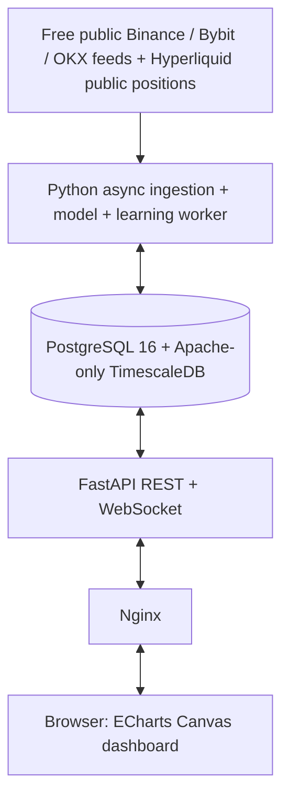

# Architecture

LiquidHeat runs five containers in a project-specific Docker Compose network. Only Nginx binds a selected loopback/LAN port. PostgreSQL and the API have no host port bindings.

## Observation layer

Independent adapters normalize native contracts, BTC quantities and USD notional. Durable checkpoints, primary-key deduplication, reconnection/backoff, coverage records and bounded catch-up support recovery. Trade/mark candles, OI, funding/available ratios, live aggregate trades, volume profiles and reported liquidation events are separate records. Feed sampling and historical retention limits remain explicit. Exchange risk metadata is versioned where available; inaccessible account-specific data is not fabricated.

## Exposure layer

Gross OI has both counterparties. New-position inference combines positive native OI change with a conservative prior on residual traded turnover, accounting for both matched contracts. Directional vulnerability and assumed leverage mixtures determine modeled vulnerable fractions; they do not create unequal gross long/short OI. Observed trade profiles are preferred to a weighted typical-price fallback. Exchange risk/collateral scenarios generate uncertain thresholds. Integrated Gaussian bucket probabilities preserve modeled mass across a $25 base grid, with wider display aggregation available.

Mark-price sweeps, closure assumptions and decay update surviving exposure. Checkpoints and immutable historical snapshots allow deterministic replay. Base hidden-position priors remain uncalibrated; `conservation-v1.0` and alpha `0.04` are recorded explicitly. CLLD is long minus short exposure; its normalized oscillator divides by their sum.

## Learning layer

The same engine schedules prospective reported-Bybit-flow forecasts, receipt audits, frozen outcomes, ridge candidates, fixed future evaluation, promotion and rollback. It never trains on future outcomes or modifies historical heatmap states. Detailed protocol: [LEARNING.md](docs/LEARNING.md).

## Serving and storage

FastAPI exposes filtered snapshots, candles, profiles, CLLD, concentration zones and diagnostics. Historical responses use about 288 display columns, compressed matrices are stored as zlib payloads, and optional `since` requests limit refresh scope. WebSockets carry compact observations/state notifications; clients do not receive an entire full-history matrix for each tick. Nginx limits requests/connections. ECharts uses Canvas plus a rasterized heatmap layer and synchronized numeric axes.

TimescaleDB is compiled `APACHE_ONLY=1`; no TSL module, licensed compression or proprietary scheduling is used. Application maintenance drops expired chunks and bounds ordinary-table learning retention. Restart policies, generated project startup units and persistent volume state support unattended operation. Container resource ceilings, one BLAS thread, small DB pools, bounded logs and a soft storage pause reduce shared-server pressure. These are not host-wide quotas.

## Independent Hyperliquid source

The same engine runs a bounded public-account collector with its own two-connection HTTP/WebSocket connector. The broader published leaderboard and both counterparties of all valid received BTC fills add query candidates. Public fills only discover accounts: reported position states determine exposure. The registry caps at 100,000 accounts, and the current sample ranks at most 1,000 fresh BTC positions. It is not a global top-1,000 census.

`hl_accounts` persists latest successful observations and discovery signals. `hl_snapshots` records compressed direct-bin matrices and normalized constituents every five minutes. No CEX smoothing, leverage prior, decay, or inferred sweep is applied. A repeatable-read response uses one account selection for profile and CLLD consistency. `source=hyperliquid` selects the separate REST path; default API `source=cex` preserves compatibility. The UI defaults to Hyperliquid and keeps the two methods separate. See [method and sampling limits](docs/HYPERLIQUID.md).

## Expanded Hyperliquid discovery

Migration 006 adds a persistent account queue, bounded all-fill deduplication, relationship discovery, per-account retries and first-discovery attribution. The existing container resource limits are unchanged. See [DISCOVERY.md](docs/DISCOVERY.md) for scheduling, capacity, percentage denominators and limitations. Run `python -m scripts.verify_discovery` inside the engine image for disposable-database integration checks.

The CEX experiment worker is a fifth resource-limited service. It only reads necessary stored inputs and writes new cex_* tables under a restricted SQL role. Original calculations and Bybit learning features remain conservation-v1.0. Hyperliquid and learning modules are unchanged. See docs/CEX_EXPERIMENTS.md.
