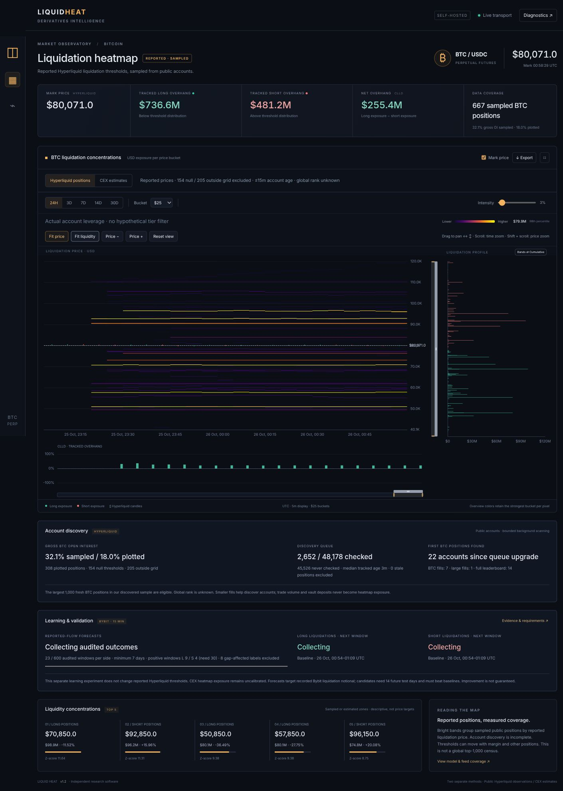
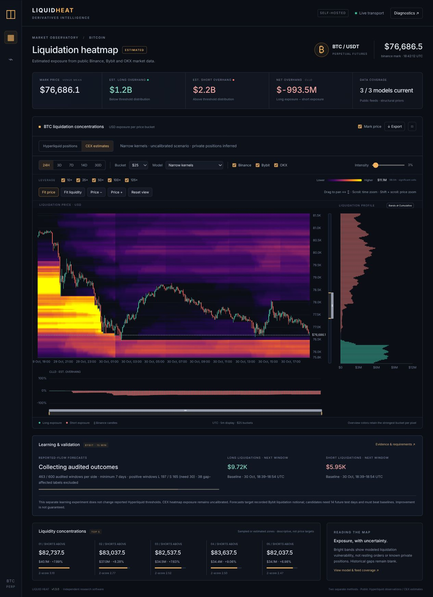
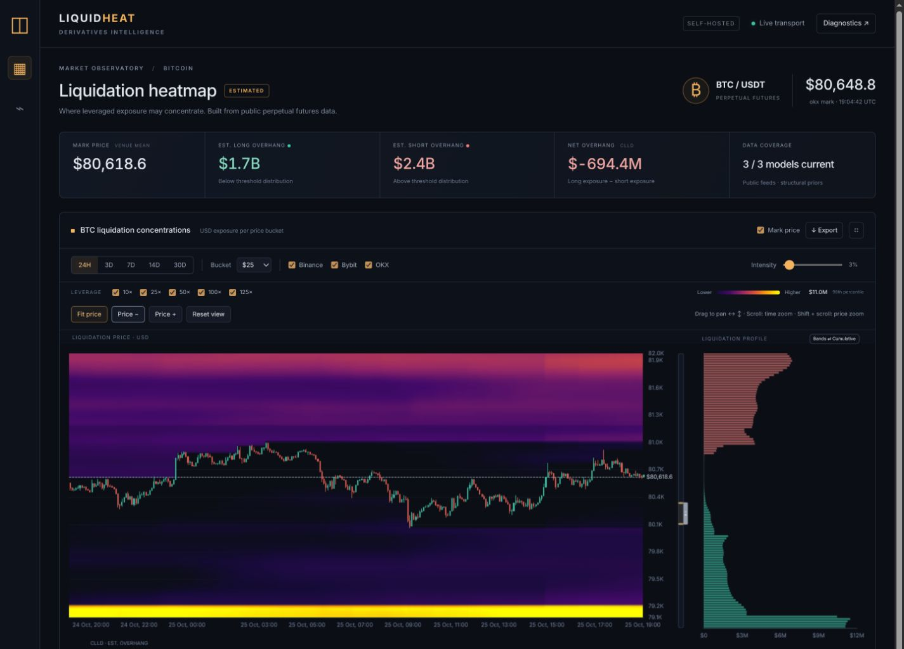
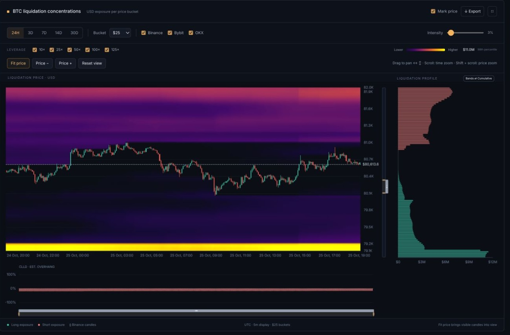
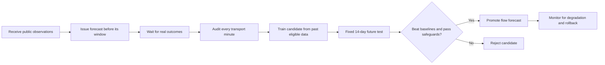
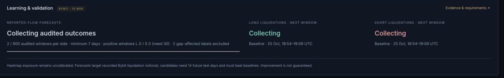

<div align="center">

# LiquidHeat

**See where Bitcoin leverage may be vulnerable. Keep the data on your own server.**

Live BTC perpetual liquidation heatmaps · Hyperliquid + three CEX venues · Audited prospective learning

[Download the Docker release](https://github.com/adlererik/LiquidHeat/releases/latest) · [Beginner installation](docs/INSTALL.md) · [Chart guide](docs/USER_GUIDE.md) · [Learning explained](docs/LEARNING.md)

**Free public market feeds. Open-source software. No exchange account or API key.**

</div>



*Actual v1.2 dashboard with real reported positions and discovery progress. Earlier account history is blank. The account sample is incomplete; no positions are fabricated or extrapolated.*



*Actual v1.3 CEX comparison, with Original weights/decay/collateral preserved. Narrower kernels sharpen individual concentrations; accumulated cohorts can still overlap. This is an uncalibrated scenario, not a copy of private exchange positions.*

<details><summary>See the separate CEX estimate dashboard</summary>



*CEX view, captured from the actual application using public exchange data. The bright bands are modeled exposure, not known private positions. A new installation builds its own history; no database or demo market data is bundled.*

</details>

## Your own Bitcoin market observatory

LiquidHeat offers two separate heatmap methods: **Hyperliquid positions** groups public account-reported liquidation thresholds; **CEX estimates** infers vulnerability from Binance, Bybit and OKX observations. The methods never blend their amounts. The Hyperliquid sample is incomplete and is not a verified global top 1,000. Explore price levels, follow the candles through time, compare leverage scenarios, and inspect how much evidence supports an experimental liquidation-flow forecast.

It runs as five isolated Docker containers on hardware you already own. The browser is just a viewer: collection, calculation, historical storage and learning continue when you close it.

| Explore | What you get |
|---|---|
| Two methodologies | Switch between sampled Hyperliquid positions and independent CEX estimates |
| Live whale discovery | Broader leaderboard queue, all received BTC fills, linked subaccounts/vaults, and paced account queries |
| Historical heatmap | Horizontal concentration bands across 24 hours, 3, 7, 14 or 30 days |
| Aligned candles and mark price | Trade-price candles and an optional mark overlay on shared time/price coordinates |
| Price profile | Long/short exposure by price, with a cumulative view |
| Flexible resolution | $25, $50, $100 or $200 price buckets |
| Separate CEX comparisons | Narrow kernels, replay reference and three individual sensitivity scenarios; Original remains the default |
| CEX exchange and leverage filters | Binance / Bybit / OKX; 10×, 25×, 50×, 100× and 125× scenarios |
| Easy navigation | Drag to pan, independent price/time zoom, **Fit price** for candles and **Fit liquidity** for all bands |
| Concentration zones | Top estimated clusters, relative intensity, distance and descriptive Z-score |
| CLLD oscillator | Estimated long-versus-short liquidation overhang, in USD and normalized form |
| Learning panel | Audited outcomes, candidate progress, future-test requirements and promotion status |
| Inspectable data | JSON export, REST API, WebSocket updates, feed coverage and model diagnostics |
| Own your deployment | Persistent database, bounded resource settings, rotating backups and reboot recovery |

**Read the colors as sampled or inferred exposure, not a promise about price.** Hyperliquid prices are reported, mutable thresholds from an incomplete, staggered public-account sample. LiquidHeat cannot see centralized exchanges' private accounts, collateral or exact leverage; the CEX heatmap remains uncalibrated. It cannot place trades.

## Install without building an image

The easiest option is the **Linux x86-64 / amd64 Docker bundle** on the [Releases page](https://github.com/adlererik/LiquidHeat/releases/latest). It contains all three prebuilt images: application, Nginx frontend and the Apache-only TimescaleDB database. Engine, API and the CEX comparison worker share the application image.

You need a Linux server, Docker Engine with Compose, Python 3, `curl`, `tar` and `sha256sum`, an Internet connection to the public exchanges, and available capacity. Recommended starting point: **4 GB RAM, 2+ CPU cores and 12 GB free disk**; the installer requires at least 1,700 MiB *available* RAM and 8 GiB free storage. Budget extra space for databases and local backups. Current prebuilt release: **amd64 only**. Docker Desktop and a registry account are unnecessary.

If `curl` or Python is missing on Debian, install the prerequisites with `sudo apt-get install -y curl python3`. See the beginner guide if Docker is missing.

Run these commands **on the server that will host LiquidHeat**, not on a separate laptop used to control it:

```bash
mkdir -p ~/liquidheat-download && cd ~/liquidheat-download
curl -fLO https://github.com/adlererik/LiquidHeat/releases/download/v1.3.1/LiquidHeat-v1.3.1-linux-amd64.tar.gz
curl -fLO https://github.com/adlererik/LiquidHeat/releases/download/v1.3.1/SHA256SUMS
sha256sum --check SHA256SUMS
# Continue only if the check prints OK.
tar -xzf LiquidHeat-v1.3.1-linux-amd64.tar.gz
cd LiquidHeat
./install.sh
```

Enter your server's **private LAN IPv4 address** when asked. It must be an address assigned to that server. Pressing Enter instead selects local-only access. The installer uses port `18443` unless you choose another:

```bash
./install.sh --bind YOUR_SERVER_LAN_IP --port 18443
```

Replace `YOUR_SERVER_LAN_IP` with the actual address; do not type it literally. Open `http://YOUR_SERVER_LAN_IP:18443` in your browser. The installer prints the exact URL.

The installer checks Docker access, resource headroom, port availability and project-name collisions; verifies and loads the image archive; generates a mode-0600 database password; and starts only this Compose project. On a regular user's working systemd session it configures project startup and a daily backup timer. **Rootless Docker is recommended.** Its daemon and user services need boot persistence; the [beginner guide](docs/INSTALL.md) covers this, including Docker prerequisites and SSH access.

A new installation starts with **Hyperliquid positions** and records account history from collection onward. The broader account queue and public BTC fills build the sample over time. **Fit liquidity** shows all reported price bands; **Fit price** finds the candles. The separate CEX view can show **Building the observed market history** while real data arrives. There is no seeded synthetic chart. Historical candles can backfill up to 30 days where exchanges provide them; open interest and trade profiles have different limits. Older estimated matrices and learning outcomes cannot be conjured from missing observations.

Already have Docker and want a local-only unattended install?

```bash
./install.sh --non-interactive --bind 127.0.0.1 --port 18443
./liquidheat.sh doctor
```

For a server hosting other services, read the [shared-server precautions](docs/INSTALL.md#shared-server-checks) first. The installer does not install a daemon, run host firewall commands, restart unrelated services or reuse an unknown project's volume. An existing rootful Docker daemon can create its normal network/firewall rules when adding a bridge network; rootless Docker avoids host-level bridge rules.

## Read the chart in one minute

1. **Choose the method.** Hyperliquid uses reported account thresholds; CEX uses inferred leverage scenarios. **Fit liquidity** shows all bands. **Find the candles:** Click **Fit price**. Green/red candles describe actual exchange trades; the optional mark line is the venue's liquidation reference price.
2. **Look across price.** Brighter horizontal bands mean more modeled exposure in that price range. Yellow is relatively intense; purple is lower intensity.
3. **Look through time.** Each column records the selected method's observed/model state. Hyperliquid bands change when sampled account thresholds or positions change, or observations become stale. CEX bands also reflect assumed closures, sweeps and decay. Blank coverage is not invented.
4. **Check the side profile.** It summarizes exposure by price for the current state. Cumulative mode adds amounts progressively across price.
5. **Compare assumptions.** Change exchange, leverage and bucket filters. Filtering to 100× means the model's 100× scenario, not confirmed 100× accounts.
6. **Check evidence.** Diagnostics describe coverage and uncertain inputs. The learning panel reports validated progress separately from the main heatmap.

**Navigation:** drag horizontally/vertically to pan; scroll over the chart to zoom time; **Shift + scroll** to zoom price. Scrolling over the right-hand profile zooms price. **Price + / −** change the price scale. **Reset view** returns to the full selected window and fits the candles.

Hyperliquid color scaling uses its original **98th percentile**. CEX uses the **98.5th percentile** of positive cells at least 1% of the selected maximum, so tiny Gaussian tails do not set the color ceiling. The intensity slider hides weaker bands; it does not create or delete positions. Changing filters can change relative colors. Compare the USD values as well as brightness.



[Full chart guide and glossary →](docs/USER_GUIDE.md)

## Self-learning, without pretending to know the unknowable

LiquidHeat includes an **automatic, auditable learning pipeline** for a narrow question:

> How much *reported Bybit BTCUSDT liquidation notional* will be recorded in the next 15 minutes, separately for longs and shorts?

This experiment is separate from both heatmap methods. It does not train or change reported Hyperliquid thresholds, and it does not calibrate the CEX model's hidden exposure. It does not learn private account positions, predict Bitcoin's direction, or automatically make the heatmap's dollar totals accurate.



- **Collect honest labels:** a missing feed minute excludes that outcome. An audited quiet period can legitimately have zero liquidations. No backdated predictions or invented historical receipt times.
- **Wait for enough evidence:** at least 600 eligible windows per side spanning seven days, including 30 positive windows, before training.
- **Use a modest learner:** regularized ridge regression uses nearby modeled exposure, past volatility, recent reported flow and other observations available at issuance.
- **Test on the future:** a candidate stays fixed for 14 calendar days. Promotion needs at least 1,000 audited windows, 12 distinct UTC days, 30 positive outcomes and at least 80% auditable coverage.
- **Earn promotion:** at least 10% lower squared log error than the best reference, a positive lower paired-day improvement bound, and no more than 5% deterioration in USD mean absolute error.
- **Keep a way back:** material, sustained deterioration can automatically roll the forecast back to a baseline. Model artifacts and decisions persist.

Earliest promotion is roughly **three weeks of sufficient observations**, often longer. It may never pass. Time alone does not guarantee improvement. Closing the browser changes nothing; daily review runs inside the engine.



*Screenshot shows collection status, not a claim of achieved predictive accuracy.*

[Detailed learning protocol, audit rules, baselines and rollback →](docs/LEARNING.md)

## Account discovery and coverage

The discovery panel distinguishes **sampled gross OI** from **plotted gross OI**, shows pending account checks and observation age, and attributes first BTC discoveries to their original discovery path. The durable queue reserves capacity for exploration while refreshing large positions. Successfully empty accounts normally wait 24 hours, with new trade activity able to advance a check. This improves observation coverage; it is not automatic predictive calibration. [Discovery mechanics, limits and measurements →](docs/DISCOVERY.md)

## How the Hyperliquid view works

The collector retains candidates from the full published leaderboard within its safety budget, follows public subaccount/vault links, and discovers both counterparties of received BTC fills including smaller fills. The collector then queries actual account positions, ranks up to 1,000 fresh BTC positions from its discovered sample, and groups non-null reported liquidation prices into $25 bins. Larger buckets sum those values. It does not guess leverage, spread a whale across hypothetical prices, or treat a trade as proof of a new position.

Saved observations build historical streaks from collection onward. Current profiles and CLLD use the same consistent account selection. The sample can miss accounts, and reported prices can change with collateral and other positions. [Full methodology and the two Glassnode metrics →](docs/HYPERLIQUID.md)

## How the CEX estimate is calculated

LiquidHeat keeps **public observations**, **modeled exposure** and **observed liquidation reports** separate.

1. **Normalize the exchanges.** Collect trade/mark candles, live marks, open interest, funding, available position ratios, live trade distributions and reported forced liquidations. Each adapter handles venue-specific contract units and availability.
2. **Respect both counterparties.** Every outstanding contract has a long and a short. Gross long OI equals gross short OI equals one-sided exchange OI; directional vulnerability is a separate assumption.
3. **Estimate openings conservatively.** Positive OI changes identify a minimum opening component. A small prior estimates possible turnover from remaining volume after matching units and accounting for paired contracts. An executed trade is not automatically a new position.
4. **Distribute entry prices.** Prefer observed traded-volume profiles reconciled with candle volume. Where unavailable, use an explicitly labeled weighted typical-price approximation, not fake VWAP.
5. **Project uncertain liquidation levels.** Combine venue risk metadata where available with leverage, size and unknown-collateral scenarios. Integrated Gaussian bucket probabilities distribute exposure without increasing total modeled notional.
6. **Update with mark-price paths.** Sweeps, voluntary closure assumptions, OI contraction and time decay change survival. Each historical state is saved; old maps are not rewritten by today's price.
7. **Keep inference visible.** Leverage weights, calibration status, data coverage and scenario uncertainty are exposed in diagnostics. The structural opening prior remains frozen at alpha `0.04` pending stronger evidence.

The main model is `conservation-v1.0`. These are defensible, inspectable **statistical priors**, not exchange account reconstructions. Cross-margin collateral, hedging, margin additions and partial liquidation remain unknown. See [architecture](ARCHITECTURE.md) and [model validation](MODEL_VALIDATION.md).

## Terms without the jargon

| Term | Plain-language meaning |
|---|---|
| Perpetual future | A derivative that tracks an asset without a fixed expiry date |
| Long / short | Exposure that generally benefits from rising / falling price |
| Leverage, e.g. 25× | A position roughly 25 times its initial collateral; losses consume that collateral faster |
| Liquidation | An exchange closing or reducing a position when margin becomes insufficient |
| Mark price | The exchange's reference price for margin and liquidation; it can differ from the last trade |
| Bucket | A price interval: a $25 bucket near $80,000 covers a $25-wide band, not 25 BTC |
| Open interest (OI) | Outstanding futures contracts, with a long and short counterparty for each |
| USD notional | Position quantity multiplied by price; **not** collateral or an expected cash loss |
| Exposure / overhang | Estimated positions vulnerable near a level; a stock estimate, not realized liquidation flow |
| CLLD | Estimated long exposure minus short exposure; its oscillator divides by their sum |
| Magnet | A descriptive name for a concentration zone; not proof that price will move toward it |
| Z-score | How unusual a bucket's concentration is relative to other buckets; not a probability of a price move |
| Backfill | Fetching genuinely available past observations when collection starts or resumes |
| Holdout | Future observations withheld from training so a model must demonstrate performance honestly |

[More terms, examples and common interpretation mistakes →](docs/USER_GUIDE.md)

## Run it day to day

From the installation directory:

```bash
./liquidheat.sh status    # Container health
./liquidheat.sh doctor    # API, learning status and local free space
./liquidheat.sh logs      # Last 100 log lines per service
./liquidheat.sh backup    # Database archive; keep newest three
./liquidheat.sh verify-backup  # Test restore in a disposable database
./liquidheat.sh stop      # Stop only this stack; retain data
./liquidheat.sh start     # Resume using saved data
./liquidheat.sh test      # Unit and numerical checks in the application container
```

All persistent market history, matrices, model checkpoints, calibration records and learning artifacts live in a project-specific PostgreSQL volume. Container restarts reuse it. There is **no automatic hard deletion of that volume** in the helper.

Market/model history uses approximately 35-day chunk retention; raw trades six hours; learning outcomes 90 days; inactive learning models and decisions one year. The application pauses ingestion when its database exceeds a 3 GiB soft budget or its container filesystem has under 4 GiB free. These are **soft guards, not a disk quota**; images, WAL, backups, filesystem allocation and other services also need monitoring. See [operations](OPERATIONS.md).

The dashboard has no login and serves HTTP. Keep it on a trusted LAN or behind an SSH tunnel. Internet publication requires your own authenticated TLS setup. No exchange credentials, wallet permissions, order endpoints or trading automation are included.

## API and development

| Endpoint | Purpose |
|---|---|
| `GET /api/v1/heatmap` | Historical matrix, candles, price profile and CLLD |
| `GET /api/v1/magnets?limit=5` | Estimated concentration zones |
| `GET /api/v1/diagnostics` | Feed health, metadata, priors and uncertainty |
| `GET /api/v1/learning` | Audited labels, forecasts, candidates and decisions |
| `GET /healthz` | API/database health |
| `WS /ws/stream` | Marks, candles, profile/state notifications, reported liquidation events |

Hyperliquid: `/api/v1/heatmap?source=hyperliquid&lookback=24h&bucket=100`. CEX exchange/leverage assumptions are rejected for this source.

CEX example: `/api/v1/heatmap?lookback=7d&bucket=100&exchanges=binance,bybit&leverage=25,50`.

Python 3.12, FastAPI, aiohttp, asyncpg, uvloop, NumPy/SciPy; PostgreSQL 16 plus **Apache-only** TimescaleDB 2.19.3; Nginx; locally vendored Apache ECharts 5. Runtime dependencies are pinned, base image digests are pinned, and Timescale source is checksum-verified. No proprietary Timescale `tsl` module is built or shipped. [License inventory →](docs/LICENSES.md)

Build from source on your Linux build/deployment server with `./scripts/build.sh`, then `./install.sh`. Source builds download open-source dependencies; the prebuilt bundle avoids compilation. The amd64 bundle is tested; other architectures require a source build and are not release-verified.

[Development and verification →](docs/DEVELOPMENT.md) · [Release checks →](docs/RELEASE_VALIDATION.md)

## Scope and honesty

LiquidHeat is independent research software by **Erik Adler**, released under **Apache-2.0**. No affiliation with Glassnode, CoinGlass or the exchanges is implied. Its visual reference includes public Glassnode heatmap research; Glassnode publishes two separate heatmap metrics; our earlier description of it as exclusively Hyperliquid was incomplete. Our Hyperliquid account discovery is incomplete, and our CEX inference is an independent model. Neither is claimed to reproduce Glassnode's private algorithm or exact account universe. [Method comparison →](docs/HYPERLIQUID.md) It uses none of those vendors' paid data or APIs. [References →](docs/REFERENCES.md)

Reported liquidation streams can be incomplete; exchange access and historical retention vary by region and venue. USDT is treated approximately as USD. There is no guaranteed forecast improvement, confidence-calibrated private exposure estimate, profit claim, or claim of pixel-perfect equivalence.

Please report reproducible software issues without uploading `.env`, database dumps, private host details or unredacted diagnostics.


### CEX model comparisons

The CEX-only Model selector offers Original, Narrow kernels, a captured-input replay reference and three separately labelled sensitivity cases. Narrow kernels retains the original leverage weights, decay and collateral mixture. Other cases individually test no extra collateral, higher leverage weights or faster decay. Original remains the default. Hyperliquid keeps its reported-position view and original color normalization. The Bybit learner continues using Original features.

All candidates replay actual stored inputs into separate tables under a restricted SQL role. No original checkpoints, Hyperliquid or learning histories are cleared. Narrow history is five-minute; the research reference and sensitivity histories are hourly to bound disk, with five-minute current profiles. See [CEX_EXPERIMENTS.md](docs/CEX_EXPERIMENTS.md) for assumptions, replay verification, resource budgets and limitations.
